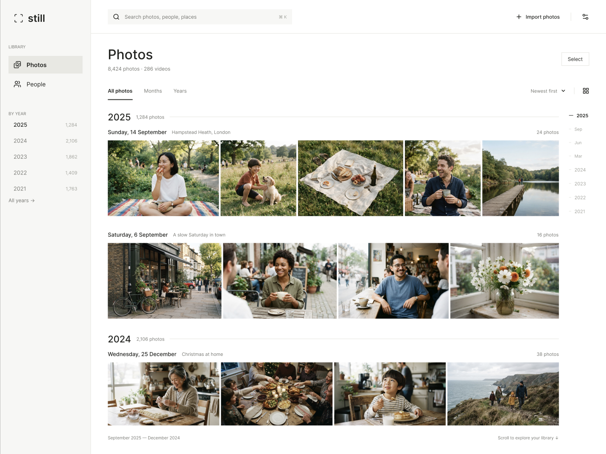
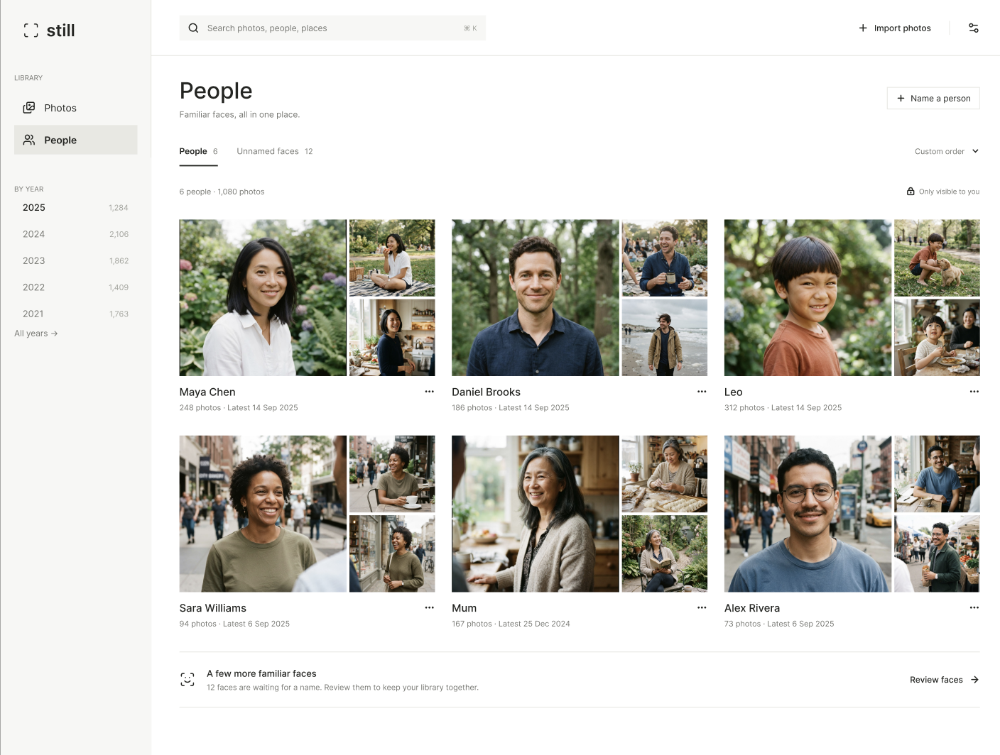

<p align="center">
  
</p>

<h1 align="center">Still</h1>

<p align="center">
  A private, local photo library for macOS. Your photos stay in your folders and never leave your Mac.<br>
  <a href="https://a3in1.github.io/Still/"><b>Download</b></a> ·
  <a href="https://github.com/A3In1/Still/releases">Releases</a>
</p>



## Features

- **Your folders, no import.** Point Still at any folder (or several). It reads photos where they are and keeps watching for new, changed or deleted files.
- **Timeline.** Every photo and video arranged by the date it was taken, with All / Months / Years zoom levels, a date scrubber and a "By year" sidebar. `⌘+` / `⌘−` change the grid size.
- **People.** On-device face detection and grouping. Name a person once and Still recognises them in new photos; **Review faces** lets you confirm, reject or reassign uncertain matches, and you can merge duplicate people.
- **Rich media.** HEIC, Live Photos (they play on hover), GIF/animated images, long exposures and videos.
- **Details and places.** An info panel shows the camera, date, size, dimensions and location on a map. You can edit the name, date, location and description.
- **Search.** `⌘K` or `/` opens the command palette to find photos and people fast.
- **Private by design.** No account, no cloud, no telemetry. Indexes live next to your photos (`.data/` in each folder) and in the app's own data folder. Face models run locally.
- **Light and dark themes**, and automatic updates.



## Install

1. Download the latest `.dmg` from the [website](https://a3in1.github.io/Still/) or [Releases](https://github.com/A3In1/Still/releases/latest).
   Requires **macOS 11+ on Apple Silicon** (M1 or newer). Intel, Windows and Linux builds are planned.
2. Open the DMG and drag **Still** into **Applications**.
3. The first time you open it, macOS may say it can't verify the developer, because the app isn't notarized yet. Go to **System Settings → Privacy & Security** and click **Open Anyway**. Or run:
   ```sh
   xattr -dr com.apple.quarantine /Applications/Still.app
   ```

### Updating

Still checks for updates every time it launches. You can also use **Still → Check for Updates…** in the menu bar. When a new version has been downloaded, the item changes to **Restart to Update**. Click it and Still relaunches on the new version.

## How to use

1. **Choose a folder.** On first launch, pick the folder that holds your photos. Add more later with **Import** in the top bar or under **Settings → Library → Folders**.
2. **Browse.** Scroll the timeline, jump to a year from the sidebar, or switch between All / Months / Years. Double-click (or press Enter on) a photo to open it, then use ← → to move between photos.
3. **See details.** Open the info panel in the viewer for camera, date and location. Edit them inline; changes are written to the file's metadata.
4. **Find people.** Open **People** and run **Find faces**. Name the groups Still finds, then use **Review faces** to tidy up uncertain matches. The scan runs in the background and can be paused.
5. **Tune it.** **Settings** has the theme, the indexed folders, Live Photo and animation playback, and the media cache size limit.

Still never moves or deletes your originals unless you explicitly delete a photo from inside the app.

## Build from source

Requirements: Node.js, Rust, Python 3.11–3.13 (3.11 recommended), and the [Tauri prerequisites](https://v2.tauri.app/start/prerequisites/).

```sh
npm install
python scripts/build_face_worker.py   # installs requirements-face.txt, downloads face models, bundles the face worker
npm run tauri dev
```

The script installs any missing packages into the active Python environment. It also downloads the InsightFace models once (existing ones in `~/.insightface/models/buffalo_l` are reused, or pass `--models /path`). The generated runtime and models are excluded from git on purpose.

To build a local app bundle, run `npm run build:desktop`. Because update signing is turned on, it needs the updater key:
`TAURI_SIGNING_PRIVATE_KEY=~/.tauri/still.key TAURI_SIGNING_PRIVATE_KEY_PASSWORD=… npm run build:desktop`

## Releasing (maintainers)

```sh
npm version patch            # bumps package.json (the single version source), commits, tags vX.Y.Z
git push --follow-tags       # GitHub Actions builds the DMG + updater files into a draft release
gh release edit vX.Y.Z --draft=false --latest   # publish: the website and in-app updater pick it up
```

The website in `site/` deploys to GitHub Pages automatically on push to `main`.

## License

No license has been chosen yet, so all rights are reserved for now. Bundled third-party components and their licenses are listed in [THIRD_PARTY_NOTICES.md](THIRD_PARTY_NOTICES.md). The InsightFace face models are for non-commercial use only.
